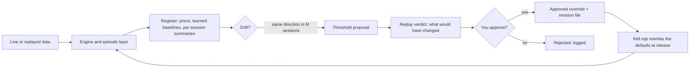

# Stream Visualizer

**A live order-flow workbench for Binance and Hyperliquid perpetuals, shipped as one HTML file, with a market "Reader" that measures its own assumptions and asks before it changes them.**

Open the file in a browser (phone or PC), press **Connect**, and watch two venues' trades, books and liquidations side by side. No server, no install, no external assets, no account. It runs offline-capable once loaded; the only network traffic is the public exchange feeds.

> Status: personal research tool under active development (30 numbered releases so far). Not financial advice; see [Safety](#safety).

---

## Why this exists

Most order-flow dashboards show you numbers and leave the interpretation to you. Most "signal" tools hide their thresholds in code and never tell you when the market stopped behaving the way those thresholds assume.

Stream Visualizer tries to do both jobs honestly:

1. **Show the raw tape well**: bubbles, CVD, heatmaps, imbalance, basis between venues, sweeps, beeswarm, treemap and more.
2. **Describe what is happening in neutral language**: "aggressor" and "passive side", never bull or bear, with an evidence checklist you can audit.
3. **Know its own limits**: every threshold the Reader uses is an explicit, measured *assumption*. When the data stops matching, the Reader flags drift, proposes a change, replays history to show what it would have done, and **waits for you to approve it**.

## Highlights

| | |
|---|---|
| **One file** | `stream-visualizer_vNNN.html`, self-contained. Copy it to a phone and it works. |
| **Two venues at once** | Binance USD-M futures and Hyperliquid, trades, books, liquidations, open interest, basis. |
| **Five areas** | Live (overview, charts, microstructure, visualizations, tape), Reader, Trade, Market, Diagnostics. |
| **Episode-based Reader** | Phenomena have a lifecycle (forming, active, fading, ended, resumable) with a back-dated start and a multi-variable evidence checklist. |
| **Self-revising** | A register of assumptions, per-variable drift detection, threshold proposals, replay verdicts, and an approval step. |
| **Flow landscape** | A 3D surface of where, and how long ago, buyers and sellers hit the book (price x age x net aggressor flow), with a playhead that walks through live history or a recorded session, and the Reader's episodes marked on the floor where and when they happened. |
| **Record and replay** | Save a live session to a file, load it on any device, replay it with different thresholds, and label episodes agree / disagree / missed. |
| **Pure, tested engine** | The Reader engine has no DOM and no timers, and 92 simulator scenarios run on every build; a failing one aborts the build. |
| **Trading built in** | A simulated paper broker filled against live prices, Binance's own demo account, or a real-money Binance account behind an explicit acknowledgement. |

## Quick start

1. Download the newest `stream-visualizer_vNNN.html` from the repository root (highest number wins).
2. Open it in Chrome, Edge, Firefox or Safari. A phone browser works too.
3. Press **Connect**. The header shows how many sockets are up (`2/2 sockets`).
4. Open the **Reader** tab and let it run. It calibrates for about two minutes before it detects anything.

Sessions, the register and your approvals are kept in the browser's local storage. Export them from the Reader tab; they are plain files.

## The Reader

The Reader turns streams of trades and book updates into **episodes**: one market phenomenon with a start, a middle, an end and the possibility of resuming.

| Family | What it looks for |
|---|---|
| **Absorption** | One side hits hard, price barely moves, the passive side refills. |
| **Exhaustion** | A previously dominant aggressor fades near an extreme while trade size and count shrink. |
| **Aggression burst** | Abnormal one-sided flow with price actually moving and the other venue agreeing. |
| **Wall** | A large resting level appears, gets re-posted, eaten or pulled. |

Each episode reports when it was *detected*, a *back-dated start*, and a checklist of the evidence that did or did not hold, across fast and mid horizons and both venues.

Alongside the episodes there is a layer of **raw one-off events**: wall appears / pulled / eaten, thinning book, imbalance flip, spoof-like patterns, sweeps and liquidations, plus (from v019) **silence** (a venue goes unusually quiet), **cross-venue lead/lag** (one venue moves first and the other follows within a second) and **trade clustering** (a run of same-size same-side prints). Raw events are single timestamped facts that never alter episodes.

### Sigma: the ruler everything is measured with

Price moves are measured in *sigmas*: the scale of normal movement on that venue right now (the 75th percentile of absolute deviation of overlapping 15-second returns, scaled to bps per root second). Because a ruler can be wrong from the start, which drift checks never catch, price progress also carries a **static expectation** (a typical move of about 0.5 to 1.2 sigma, tails around 1.3 to 3.2) that is checked against everything seen so far. See [ADR 0004](docs/adr/0004-sigma-is-a-15-second-mad.md).

### The self-revising loop



The rule that holds the whole design together: **the register, drift and proposal code never changes a detection by itself.** Only a threshold you approved does. Baselines update automatically; thresholds do not ([ADR 0001](docs/adr/0001-baselines-adopt-thresholds-need-approval.md)).

### Record, replay, label

- **Record** a session (optionally thinning quote updates), **save** it as `session_<SYM>_<time>.json.gz`, **load** it anywhere.
- **Replay** with the current or edited thresholds and compare the episode counts.
- **Timeline** shows episodes as spans over the price line; mark each one **agree**, **disagree**, or add a **missed** label. Labels feed the weekly review.

## Weekly review

1. In the Reader tab, export the **review report** and the **register**.
2. Look at *To review*: drift flags, scale warnings, pending proposals.
3. Approve or reset a threshold; the app downloads a **revision file**. Drop it into `docs/revisions/`.
4. Before a release:

```bash
node fold.mjs --check      # preview what the next fold would change
node fold.mjs              # rewrite the matching defaults, mark files "Folded: yes"
node build.mjs             # self-test + dev build
node build.mjs --release   # next stream-visualizer_vNNN.html in the repo root
```

`fold.mjs` refuses a revision file that does not fit the current defaults. See [docs/revisions/README.md](docs/revisions/README.md) and [ADR 0003](docs/adr/0003-approved-thresholds-are-overrides-then-folded-by-script.md).

## Building from source

Requires only **Node.js** (no dependencies, no `npm install`).

```bash
node build.mjs                       # runs the Reader self-test, writes dist/stream-visualizer.html
node build.mjs --release             # writes the next stream-visualizer_vNNN.html (never overwrites)
node build.mjs --out some/file.html  # custom output path
```

The built HTML is generated. **Never edit it by hand**; change `src/` and rebuild.

To try the dev build locally:

```bash
cd dist && python -m http.server 8765    # then open http://localhost:8765/stream-visualizer.html
```

## Testing

`node build.mjs` runs 92 simulator scenarios in a sandbox before writing anything and aborts on the first failure. They cover each detector and episode family, the register, drift, proposals, replay determinism, the sigma estimator and static expectation, save/load round trips, and (for v019) the raw events, including a check that adding them leaves every older detection and episode **byte-identical** on a recorded session.

Rule of thumb in this repo: any new engine behaviour ships with a scenario, and any change to evidence cut-offs is byte-compared on simulated and recorded data before and after.

## Project layout

```
src/
  index.html            page skeleton, with <!--@include path--> markers
  styles.css
  js/
    app.js              feeds, charts, navigation, Reader cards
    overview.js         Overview (home) view
    reader-engine.js    pure order-flow engine + one-off detectors (replayable)
    reader-episodes.js  pure episode state machines and evidence checklists
    reader-register.js  assumption register, baselines, sessions, approvals
    reader-drift.js     pure drift judgement per variable
    reader-proposals.js pure percentile maps, proposals, replay verdict
    reader-tools.js     record / save / load / replay, timeline, labels
    reader-landscape.js pure grid maths for the Flow landscape (3D tape surface)
    reader-landscape-view.js  the 3D drawing, playhead and controls
    reader-selftest.js  simulator scenarios (run by the build)
build.mjs               self-test + single-file assembler
fold.mjs                folds approved revisions into the defaults
docs/adr/               architecture decision records
docs/revisions/         approved threshold revisions (history)
.scratch/               local specs and issues (one folder per feature)
CONTEXT.md              the domain language
```

## Design principles

- **One file, offline-capable.** No external assets, ever.
- **A pure engine.** The Reader has no DOM and no timers; exchange timestamps drive its clock, so any recording replays identically.
- **Neutral language.** Aggressor and passive side, not bull and bear.
- **Assumptions are first-class.** Named, written down, measured, and revisable, but only with approval.
- **Refactors are proven, not trusted.** Before and after replays are compared byte for byte.

The vocabulary (episode, register, baseline, drift, revision, sigma, expectation) is defined in [CONTEXT.md](CONTEXT.md); the decisions behind it are in [docs/adr/](docs/adr/).

## Data sources

Public market data only, read directly by your browser:

- Binance USD-M futures: `fstream.binance.com` (WebSocket) and `fapi.binance.com` (REST: depth snapshot, open interest, server time).
- Hyperliquid: `api.hyperliquid.xyz/ws`.

Nothing is relayed through any server of ours. There is no backend.

## Safety

- This is a research and visualization tool. **Nothing here is financial advice**, and detections are descriptions of what the tape did, not predictions.
- The **simulated paper** broker sends nothing anywhere.
- The **Binance demo** account uses keys you create in Binance Demo Trading and talks to `demo-fapi.binance.com`. API keys are used from your browser; give them the narrowest permissions possible (no withdrawals) and never use a key you cannot afford to lose.
- The **Binance live** option places real orders with real money. It is off until you enter keys and tick the acknowledgement that you are responsible for them. Use it at your own risk, and prefer the paper broker or the demo account while testing.

## Contributing

This is a personal project and external changes are not being actively sought, but issues and ideas are welcome. If you do send a change: edit `src/` (not the built file), run `node build.mjs`, add a self-test scenario for new engine behaviour, and keep UX changes separate from engine, trading and feed changes (one step, one release).

## License

No license has been chosen yet, so all rights are reserved by default. If you want to use the code, open an issue.
